<p align="center">
  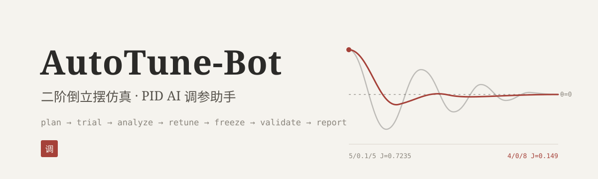
</p>

<p align="center">
  <i>让模型提出实验，让仿真给出答案，让每一轮都留下证据。</i>
</p>

<p align="center">
  <a href="https://github.com/DRAG0NM/AutoTune-Bot/actions/workflows/validate.yml"></a>
  =24.10" src="https://img.shields.io/badge/Node.js-%3E%3D24.10-2b2a28?style=flat-square&logo=nodedotjs&logoColor=f5f3ee">
  
  
  <a href="LICENSE"></a>
</p>

<p align="center">
  <a href="docs/project-description.md">项目说明</a> ｜ <a href="docs/reproduce.md">从零复现</a> ｜ <a href="docs/simulation-manual.md">仿真手册</a> ｜ <a href="docs/sources-and-ai.md">来源与AI披露</a> ｜ <a href="docs/submission-checklist.md">赛事材料对照</a>
</p>

PID 整定要在响应速度、超调、残差和控制量之间来回权衡。一张好看的曲线、一组低 J 的参数，都证明不了"调参过程"本身有效：失败的候选、试验条件和每次决策的理由同样需要留下来。

**AutoTune-Bot 让 AGNES 当一名会做实验的调参助手。** 它先问清预算和目标，跑基线，读结构化指标，决定下一组参数并真正执行，再冻结已测最优、换条件验证，最后自动交付 CSV、图表和报告。数值积分和 PID 运算全部由确定性的 Node.js 工具完成，模型只负责提出实验和解释反馈。

<p align="center">
  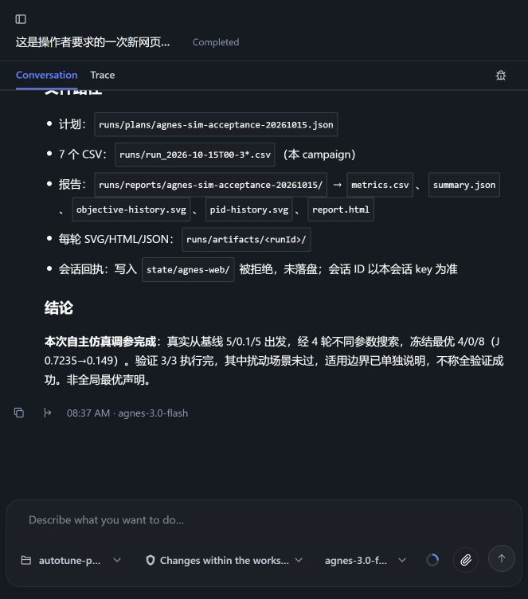
</p>
<p align="center"><sub>2026-10-15 真实 AGH 会话完成截图。截图只作直观展示，模型调用、反馈顺序和执行参数以完整 JSONL 与离线校验为准。</sub></p>

## 亮点

- **真闭环，不是参数表。** 模型提出的每组参数都会被实际仿真，返回指标后再决定下一步；逐轮决策理由和 parent 链全部入档。
- **先冻结，再验证。** 搜索结束后冻结已测可行最优，再用不同噪声种子、反向初态和角速度冲量独立验证；验证前拒绝非最优或不可行参数。
- **失败照常展示。** 未收敛的基线、未通过的验证场景、模型的误判和错误时间估计都原样保留，不改写、不挑选。
- **离线可复核。** `verify:submission` 用冻结源码重新生成七轮状态轨迹、复算全部指标，并逐条配对模型的参数提议和工具返回，无需网络或 API Key。
- **零依赖，自带报告。** 每轮自动产出原始 CSV、指标 JSON、响应/控制量/相轨迹 SVG 和可离线打开的 HTML。

## 一次真实会话

2026-10-15，`agnes-3.0-flash` 在 AGH 中完成 4 次搜索与 3 次冻结参数验证：373 个连续事件，17 次工具调用全部有返回，7/7 正式 runId 覆盖。

| 轮次 | 做了什么 | Kp/Ki/Kd | J | 结果 |
|---|---|---|---:|---|
| 搜索 1 | 初始基线 | 5/0.1/5 | 0.7235 | 未收敛 |
| 搜索 2 | 已知历史先验复测 | **4/0/8** | **0.1490** | 收敛 |
| 搜索 3 | 降低 Kp | 3.5/0/8 | 0.3251 | 未收敛 |
| 搜索 4 | 提高 Kd | 4/0/12 | 0.1669 | 收敛 |
| 验证 1 | 更换 seed | 4/0/8 | 0.1531 | 通过 |
| 验证 2 | 负向初态 | 4/0/8 | 0.1526 | 通过 |
| 验证 3 | 10°/s 角速度冲量 | 4/0/8 | 0.3265 | 未通过 |

4/0/8 是已知历史先验，本次是复测而非从零发现；模型提出的两个新候选都没有超过它。验证 3 在 1050 ms 后恢复，但整轮末段均值误差 0.1824° 超过 0.1° 门槛，按规则记为未通过。[七轮 CSV 与指标](evidence/07_simulation-release-20261015/campaign/index.jsonl) · [完整 HTML 报告](evidence/07_simulation-release-20261015/campaign/reports/agnes-sim-acceptance-20261015/report.html) · [证据索引与离线复核](evidence/07_simulation-release-20261015/README.md)

<table>
  <tr>
    <td width="50%">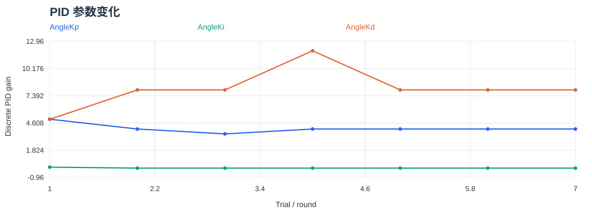<br><sub><b>参数轨迹</b> — 七轮实际执行的 Kp/Ki/Kd。</sub></td>
    <td width="50%">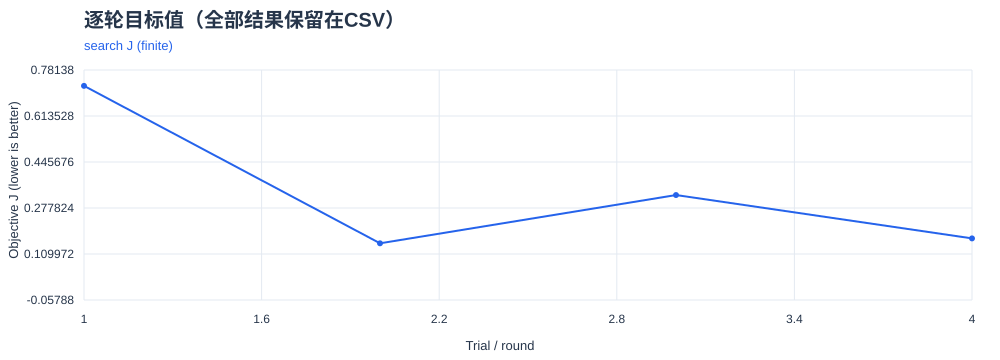<br><sub><b>目标值</b> — 搜索与验证的 J，未收敛轮次照常画出。</sub></td>
  </tr>
  <tr>
    <td width="50%">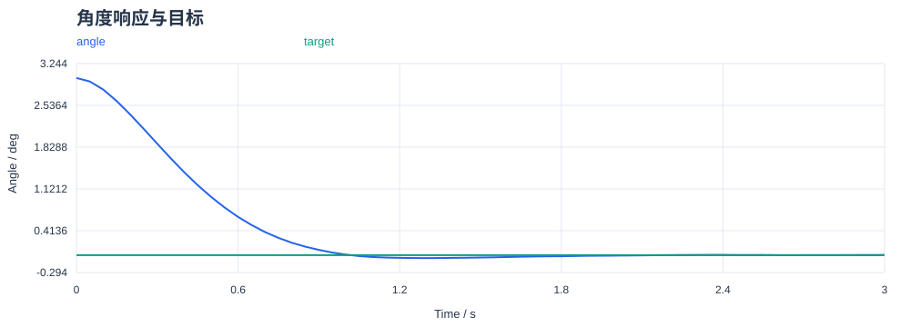<br><sub><b>角度响应</b> — 4/0/8，J=0.149，收敛。</sub></td>
    <td width="50%">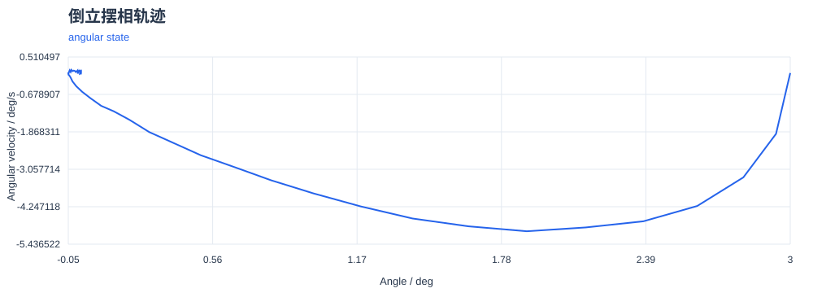<br><sub><b>相轨迹</b> — 同一轮的 θ/ω 收向原点。</sub></td>
  </tr>
</table>

## 快速开始

只需要 Node.js >=24.10，没有第三方运行依赖。

**离线复核（无需模型账号）**

```bash
npm test                  # 数值模型、工具、报告与启动入口测试
npm run selftest          # 正常 / 边界 / 失败共 9 例
npm run verify:submission # 复现七轮轨迹并配对模型调用链
npm run demo              # 固定参数演示，输出 report.html
```

`demo` 用固定参数验证工具和产物，不调用模型，不算 AI 自主调参。

**启动 AI 调参（Windows）**

需要 PowerShell 7，以及 WSL 中已安装的 AGNES Harness：

```powershell
& '.\启动调参助手.ps1'
```

脚本会打开 AGNES 网页端（默认端口 4177），并注入本项目的 `agent.md`、Skill 和使用手册。在新会话里给出时间、轮数和目标即可开始。首次初始化会请求一次模型回复；框架的工具执行授权按网页提示处理。发行版和 AGH 安装路径可通过启动参数指定，见[使用手册](docs/simulation-manual.md)。

**手动跑一轮**

```bash
node bridge/cli.js trial --backend sim --gains 'Kp=4,Ki=0,Kd=8' --dur 3000 --json
node bridge/cli.js report --campaign YOUR_CAMPAIGN --json
```

默认模拟 3 秒，可选 1–60 秒，每 10 ms 一步。模拟时长和 AGNES 的思考耗时分开计算；时长会改变评价，须在实验计划里统一。

## 工作流程

```text
 询问 ──► 基线 ──► 分析 ──► 选参执行 ──► 冻结 ──► 验证 ──► 报告
 预算/目标  首轮仿真  读取指标   反馈循环      已测最优   换条件     CSV/SVG/HTML
```

| 环节 | 谁来做 | 内容 |
|---|---|---|
| **计划** | AGNES + 工具 | 冻结搜索工况、参数范围、轮数和评价配置，之后不可改动 |
| **仿真** | Node.js 工具 | 非线性二阶单倒立摆（θ/ω），10 ms 控制步、50 ms 采样，固定种子可重现 |
| **评价** | Node.js 工具 | 先过摔倒与收敛门，再比较超调、调节时间、稳态误差和控制量平方积分组成的 J，并输出各加权分项 |
| **选参** | AGNES | 读指标与诊断，给出下一组参数和理由，记录 parent 链 |
| **验证** | AGNES + 工具 | 冻结已测最优，换噪声种子、初态和扰动独立验证 |
| **审计** | AGH + 工具 | 会话导出、工具调用回执、源码与 CSV 散列；生成报告时复算指标 |

## 自动产物

- **每轮**：原始状态 CSV、指标与诊断 JSON、角度响应/控制量/相轨迹 SVG、可离线打开的 HTML。
- **每批**：全部成功及失败轮的 `metrics.csv`、PID 变化图、目标值变化图、汇总 JSON/HTML。
- **审计**：冻结计划、逐轮决策理由与 parent 链、源码和 CSV 散列。

## 边界与局限

- 这是单套假设数值模型上的有限搜索。不是物理设备验证，不是双摆或高保真数字孪生，也不承诺全局最优。
- PID 沿用既有离散约定（积分逐步求和、微分为测量差），参数不能直接换算成连续时间 PID。
- 验收中出现过一次 CLI 无法审批和一次框架 TRANSPORT 错误，随后在网页恢复；Codex 逐项核准了框架工具请求，候选选择与执行命令由 AGNES 提出。这是有工具审批的自主决策闭环，不是无人监督。
- 模型曾误判 J 主项、过度归因积分影响，并把实际 6 分 35 秒误报成 4.5 分钟。原记录未改写，工具和指令已补充修正；离线测试不能保证模型以后不再犯错。
- 轮数有工具限制，模型推理的墙钟预算尚无硬截止。旧设备路线已退休，不参与当前流程。

## 证据图集

两组图集分开展示：上面是本次会话由项目工具生成的产物，下面是仓库原有的历史仿真闭环。所有图都保留成功与未通过的结果。

### 本次会话：七轮单轮图

每轮包含角度响应、控制量和相轨迹；模型、单位与指标定义见[仿真手册](docs/simulation-manual.md)。

<details>
<summary>搜索1：初始基线 · 5/0.1/5 · J=0.7235 · 未收敛</summary>

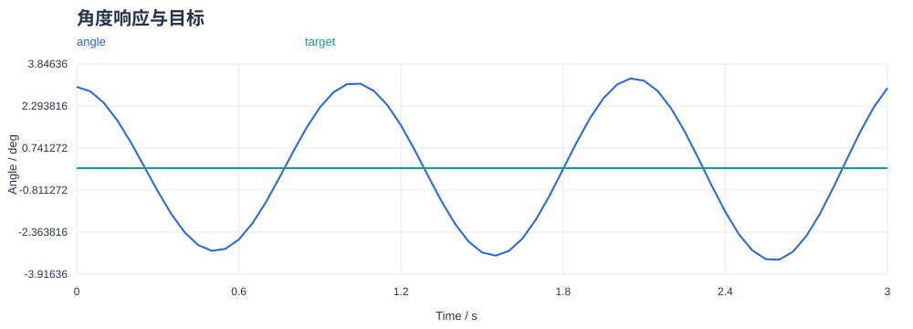

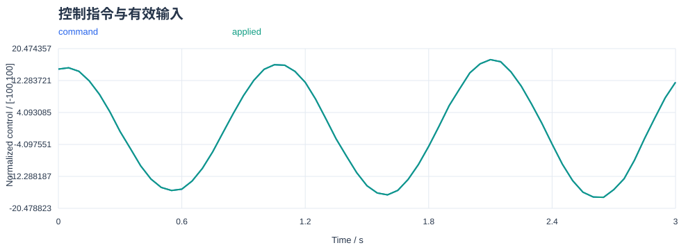

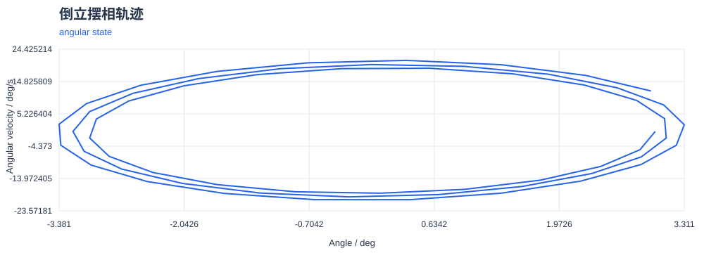

</details>

<details>
<summary>搜索2：已知先验复测 · 4/0/8 · J=0.149 · 收敛</summary>


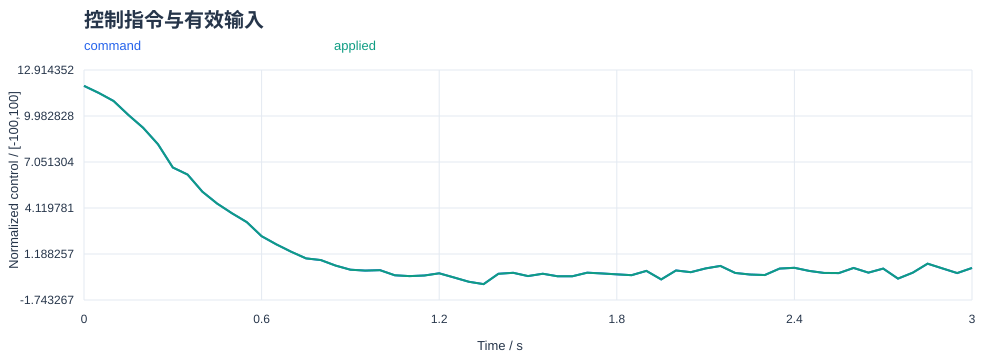


</details>

<details>
<summary>搜索3：降低Kp · 3.5/0/8 · J=0.3251 · 未收敛</summary>

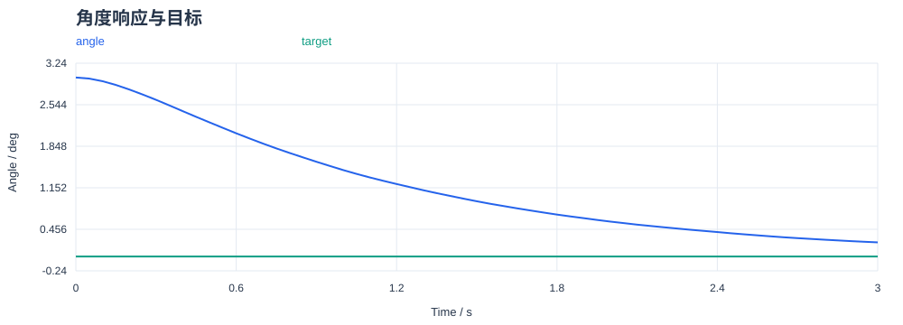

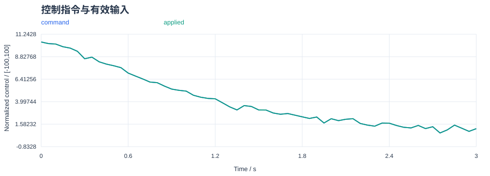

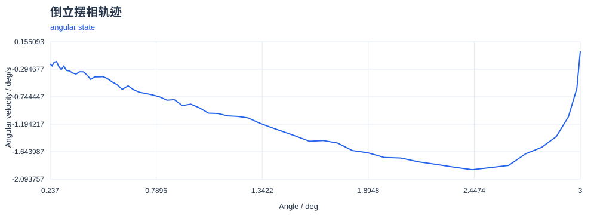

</details>

<details>
<summary>搜索4：提高Kd · 4/0/12 · J=0.1669 · 收敛</summary>

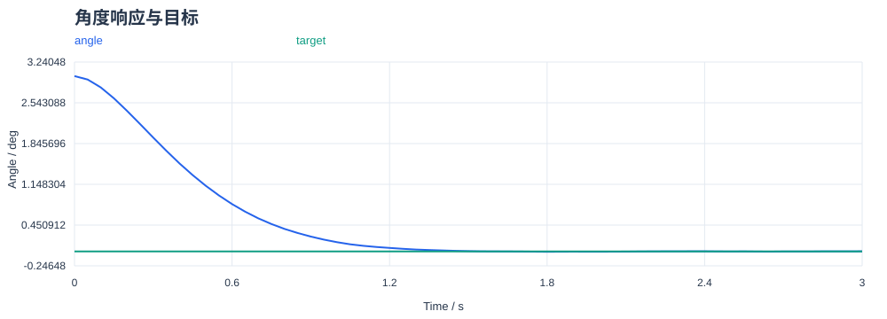

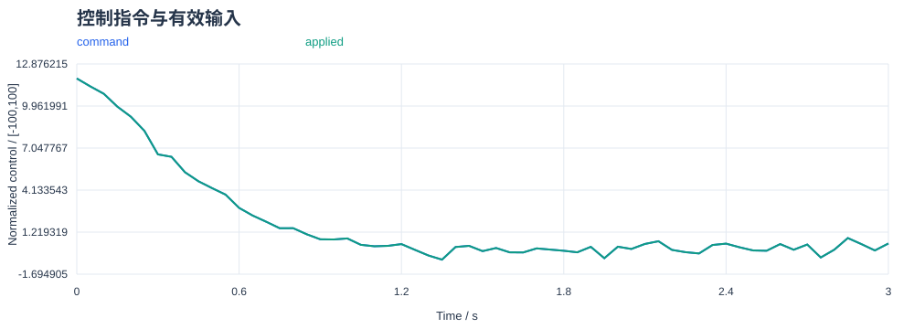

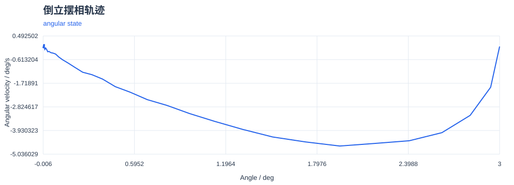

</details>

<details>
<summary>验证1：更换seed · 4/0/8 · J=0.1531 · 收敛</summary>


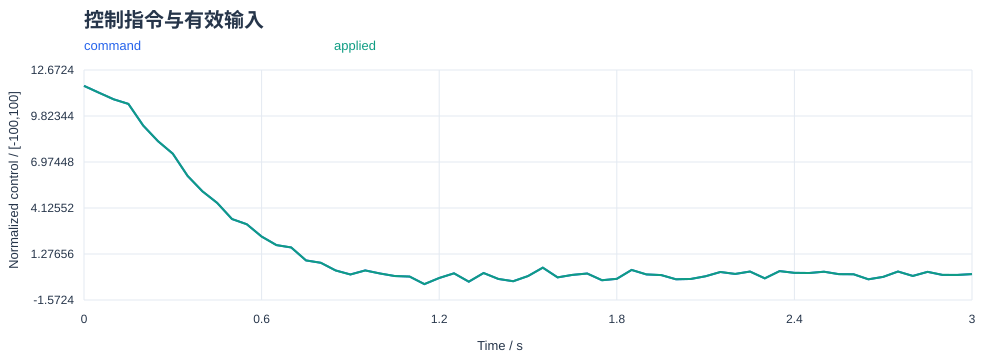

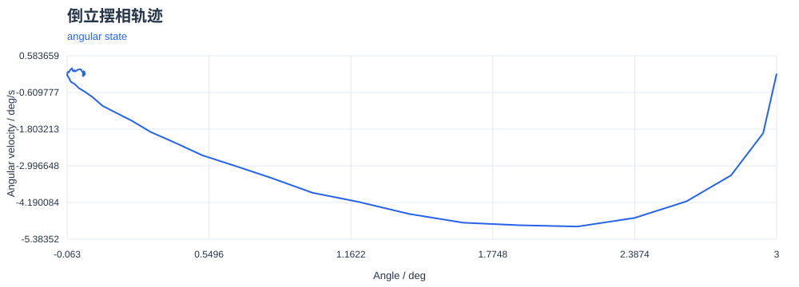

</details>

<details>
<summary>验证2：负向初态 · 4/0/8 · J=0.1526 · 收敛</summary>

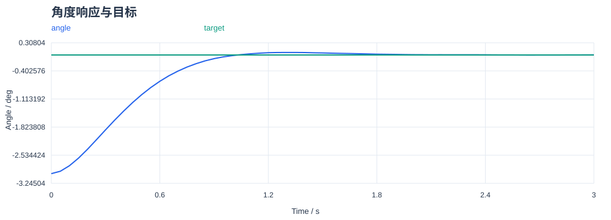

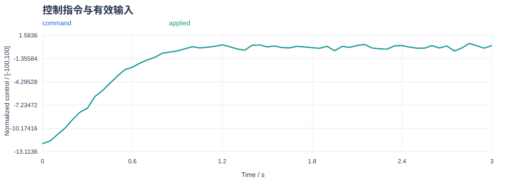

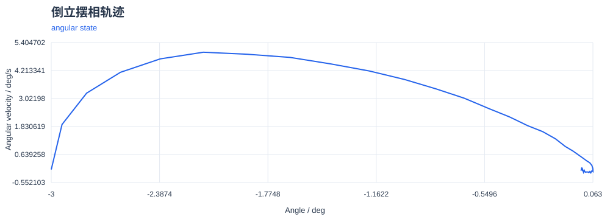

</details>

<details>
<summary>验证3：角速度冲量（未收敛） · 4/0/8 · J=0.3265 · 未收敛</summary>

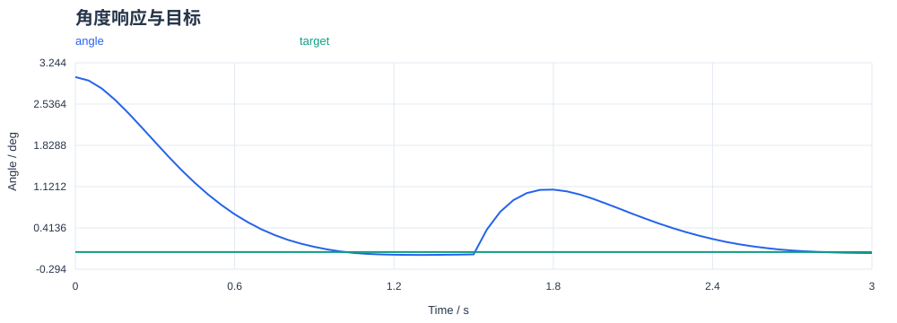

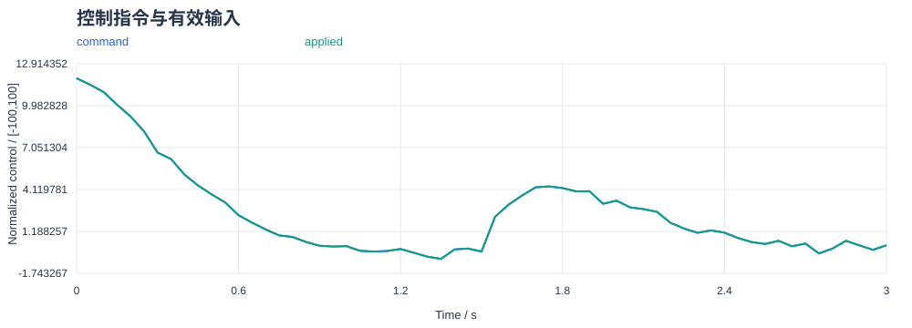

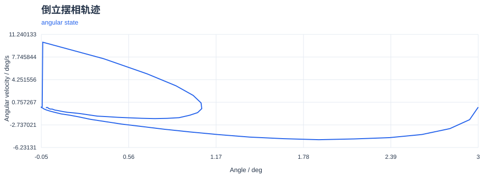

</details>

### 历史仿真闭环（2026-10-10）

15 组图来自仓库原有的 2026-10-10 仿真数据：12 批实验、110 条运行记录，自主搜索、固定参数对照和脚本网格分别标注。不同阶段的模型、目标和评价口径不同，J 不跨批直接排名。

图本身不能单独证明模型参与，依据是 [AGH 会话记录](evidence/01_agh/README.md) 和[会话审计](evidence/01_agh/session-audit.json)：8 份历史导出满足完整性检查，M2 两份导出不完整，只能提供有限交互证据。详见[验证报告](evidence/05_validation/report.md)与 [15 组图表索引](evidence/05_validation/figures/README.md)。历史图用 PNG 预览，点击打开同源 SVG。

<details>
<summary>D2-T 自主搜索与候选选择</summary>

三种控制器的逐轮搜索及独立验证；实际搜索轮数不同。

[](evidence/05_validation/figures/d2-t-search-trajectories.svg)

</details>

<details>
<summary>Stage A 搜索遥测</summary>

6条搜索的角度、控制命令、积分及J。

[](evidence/05_validation/agnes-stage-a-20261010/search-traces.svg)

</details>

<details>
<summary>Stage B 搜索遥测</summary>

4条搜索，采用时序修正后的模型。

[](evidence/05_validation/agnes-stage-b-20261010/search-traces.svg)

</details>

<details>
<summary>Stage C 搜索遥测</summary>

4条压力模型搜索。

[](evidence/05_validation/agnes-stage-c-20261010/search-traces.svg)

</details>

<details>
<summary>早期及 A–C 搜索轨迹</summary>

各面板独立评价，不按跨模型J变化排名。

[](evidence/05_validation/figures/early-search-trajectories.svg)

</details>

<details>
<summary>12批验证收敛总览</summary>

包含固定参数对照与未通过场景；不是12批全部自主搜索成功。

[](evidence/05_validation/figures/campaign-validation-scorecard.svg)

</details>

<details>
<summary>先期与 A–C 验证诊断</summary>

恢复、峰值、误差积分和控制命令平方积分。

[](evidence/05_validation/figures/abc-validation-diagnostics.svg)

</details>

<details>
<summary>D2-T 压力验证诊断</summary>

18条压力验证；保留微分滤波末条未过门的结果。

[](evidence/05_validation/figures/d2-t-pressure-diagnostics.svg)

</details>

<details>
<summary>原 D 未收敛判据</summary>

固定参数对照，18条未收敛记录均保留。

[](evidence/05_validation/figures/stage-d-criterion-breakdown.svg)

</details>

<details>
<summary>D2-M2 配对响应</summary>

固定参数、四组同工况控制器对照；M2模型会话导出不完整。

[](evidence/05_validation/figures/d2-m2-response-traces.svg)

</details>

<details>
<summary>D2-M2 配对指标</summary>

同参数及同工况下的性能比较，不当作自主选参成果。

[](evidence/05_validation/figures/d2-m2-paired-metrics.svg)

</details>

<details>
<summary>D2-M2 积分与饱和</summary>

展示机制实际触发；M2数值可复核，但交互证据不完整。

[](evidence/05_validation/figures/d2-m2-integral-saturation.svg)

</details>

<details>
<summary>Ki=0 固定网格热图</summary>

36点脚本网格，提供搜索先验；不是模型自主搜索。

[](evidence/05_validation/figures/grid-v23-ki0-heatmap.svg)

</details>

<details>
<summary>selftest 正常、边界与失败样例</summary>

9个预设工具行为样例；自检通过与控制收敛分别解释。

[](evidence/05_validation/figures/selftest-v23-outcomes.svg)

</details>

<details>
<summary>D2 本机方法探索</summary>

162点脚本实验，用于机制和工况选择；不是模型自主搜索。

[](evidence/05_validation/figures/d2-method-exploration.svg)

</details>

复核历史数值与本批执行链：

```bash
npm run verify:evidence
npm run verify:history
npm run audit:sessions
npm run verify:submission
```

## 项目结构

| 路径 | 内容 |
|---|---|
| `bridge/` | 仿真、回放、PID、指标、报告 CLI |
| `agent.md` / `.agh/skills/pid-tuning/` | 助手行为与闭环工作流 |
| `configs/` | 模型压力配置、冻结计划示例与历史仿真计划 |
| `启动调参助手.ps1` | Windows 网页启动入口 |
| `tools/` | 网页初始化辅助、工具演示、历史证据复核 |
| `runs/` | 当前轮次 CSV、JSON、SVG、HTML 及计划 |
| `evidence/` | 保留的历史仿真与真实 AGNES 会话证据 |
| `test/` | 数值模型、工具、报告及启动入口测试 |

## 许可

本项目以 [Apache-2.0](LICENSE) 许可发布，第三方声明见 [NOTICE](NOTICE)。参与贡献请先读 [CONTRIBUTING.md](CONTRIBUTING.md)。
