# 仿真实验图表索引

本目录12张总览图，加上A/B/C目录中的3张搜索遥测图，共15张不同内容的图表，覆盖参数初筛、行为样例、Agnes搜索、压力验证、未收敛诊断及控制器配对对照。每张都有SVG和同名PNG；PNG用于网页、汇报与演示文稿，来自SVG渲染，不是另一批测试数据。

图片采用展示版排版：图内保留图例、单位、工况、采样间隔与判定门槛；方法适用范围及审计情况统一在本索引和验证报告说明。

在项目根目录执行`npm run plot:evidence`重建SVG。脚本只读取已有证据，不启动trial或任何串口操作。PNG需在SVG更新后重新渲染；本次导出使用Edge无头渲染，画布按各SVG的width/height设置。验证结果见[总报告](../report.md)。

| 图表 | 主要输入（相对于`evidence/`） | 展示用途 |
|---|---|---|
| [Ki=0网格热图](grid-v23-ki0-heatmap.svg) | `05_validation/grid-v2.3-ki0.json`，36点 | 参数可行区域与网格内最低收敛J；属于本机固定网格 |
| [selftest行为样例](selftest-v23-outcomes.svg) | `06_testcases/selftest-v2.3.json`，9个样例 | 正常、边界、预期失败及回放行为；allPass与收敛分别解释 |
| [早期及A–C搜索轨迹](early-search-trajectories.svg) | `agnes-20261010-a`及`agnes-stage-{a,b,c}-20261010`的index/summary | 每批独立的搜索轨迹；跨面板模型与目标不同 |
| [Campaign验证收敛表](campaign-validation-scorecard.svg) | 12个campaign的index/summary，逐条robustness | 展示验证收敛与未收敛；case编号仅在各行内部对应本批次顺序 |
| [原D判据拆解](stage-d-criterion-breakdown.svg) | `agnes-stage-d-{baseline,conditional-integral,derivative-filter}-20261010-agent`，18条 | 两项收敛门槛及施扰后恢复时间；未恢复以叉号标记 |
| [D2本机方法探索](d2-method-exploration.svg) | `05_validation/stage-d2-method-exploration.json`，162点 | 参数、窗口与机制触发敏感性；不是Agnes自主搜索 |
| [D2-T自主搜索](d2-t-search-trajectories.svg) | `agnes-stage-d2-t-{baseline,conditional-integral,derivative-filter}-20261010` | 展示搜索选择和独立验证，包含未收敛候选 |
| [D2-M2配对响应](d2-m2-response-traces.svg) | `agnes-stage-d2-m2-{baseline,conditional-integral}-20261010`的index/summary/CSV | 四组同条件50ms采样角度响应；不是10ms控制环逐步记录 |
| [D2-M2配对指标](d2-m2-paired-metrics.svg) | 同上，四组配对 | 相同模型、参数和工况下比较J、过冲和末窗误差 |
| [先期与A–C验证诊断](abc-validation-diagnostics.svg) | 先期与A/B/C的index/CSV/diagnostics；先期另读`stage-a-historical-diagnostics.json` | 14条验证的恢复、施扰后峰值、IAE、ISE与控制命令平方积分；先期冲量时刻按旧模型的半时长语义恢复 |
| [D2-T压力诊断](d2-t-pressure-diagnostics.svg) | 三个D2-T campaign，18条验证 | 六种压力验证的连续指标；保留微分滤波末条末窗误差超限 |
| [D2-M2积分及饱和](d2-m2-integral-saturation.svg) | M2两批的controllerStats/diagnostics/metrics，四组配对 | 控制环积分峰值、饱和/积分抑制步数、调节时间、IAE、输出平方积分 |
| [A搜索遥测](../agnes-stage-a-20261010/search-traces.svg) | Stage A全部6条search CSV/index | 角度、控制命令、积分和J；重建原有同名PNG |
| [B搜索遥测](../agnes-stage-b-20261010/search-traces.svg) | Stage B全部4条search CSV/index | 同上，独立显示时序修正后的批次 |
| [C搜索遥测](../agnes-stage-c-20261010/search-traces.svg) | Stage C全部4条search CSV/index | 同上，独立显示压力模型批次 |

上表campaign目录均在`05_validation/`下。软件回归、不同阶段selftest及串口桩测试另外用总报告中的验收表呈现，不生成控制性能曲线。

逐项数值核验及数据来源见[验证报告](../report.md)，可重现的数值核验输出见[verification.json](verification.json)。生成脚本在制图前校验CSV散列、指标、诊断及控制环统计；图内归一化反向过冲以百分比表示，角度误差以度表示。

不同模型、profile或评价目标的J分别呈现。原D未收敛和D2验证未通过记录均保留。历史重复冒烟和无plan试运行不并入这些图。M2两份会话导出不完整，详见[会话记录](../../01_agh/README.md)。

## 图表预览

展开查看PNG，点击图片打开对应SVG；数据来源见上表。

D2-T自主搜索轨迹

[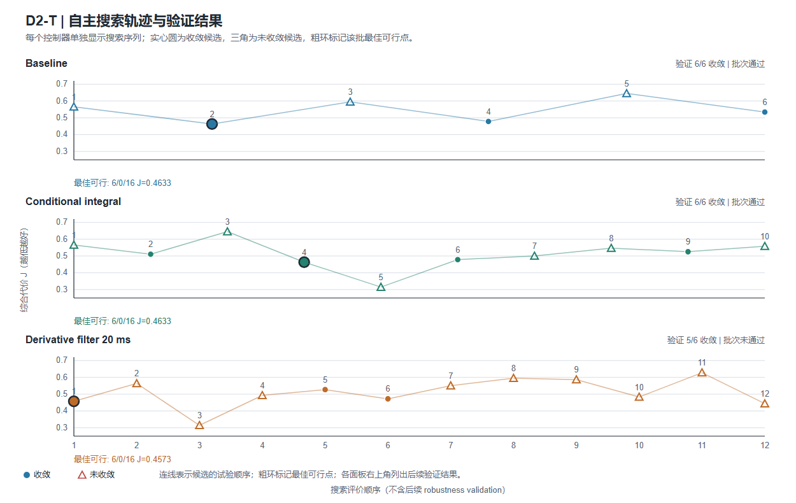](d2-t-search-trajectories.svg)

D2-M2四组配对响应

[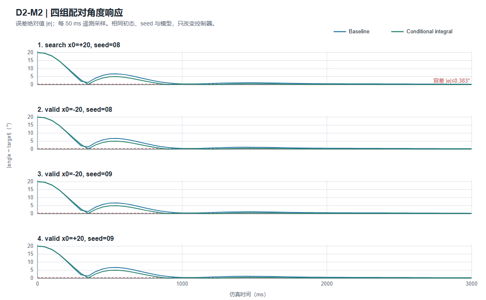](d2-m2-response-traces.svg)

D2-M2配对指标

[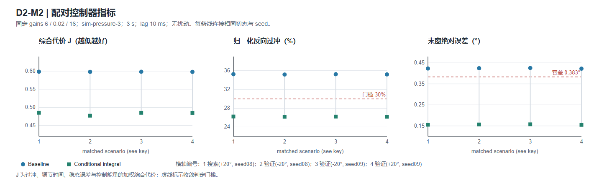](d2-m2-paired-metrics.svg)

D2-M2积分及饱和

[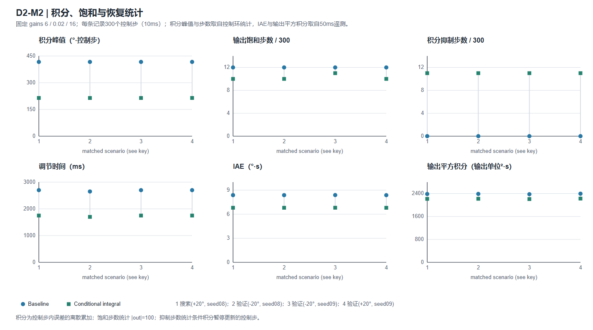](d2-m2-integral-saturation.svg)

12批实验验证收敛情况

[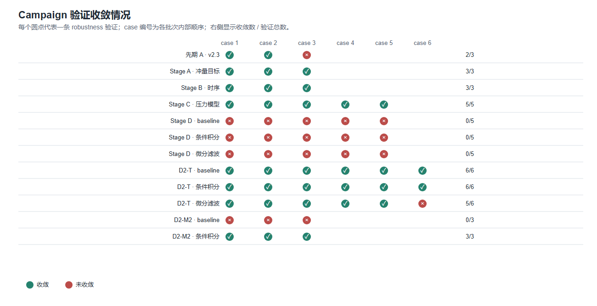](campaign-validation-scorecard.svg)

D2-T压力验证诊断

[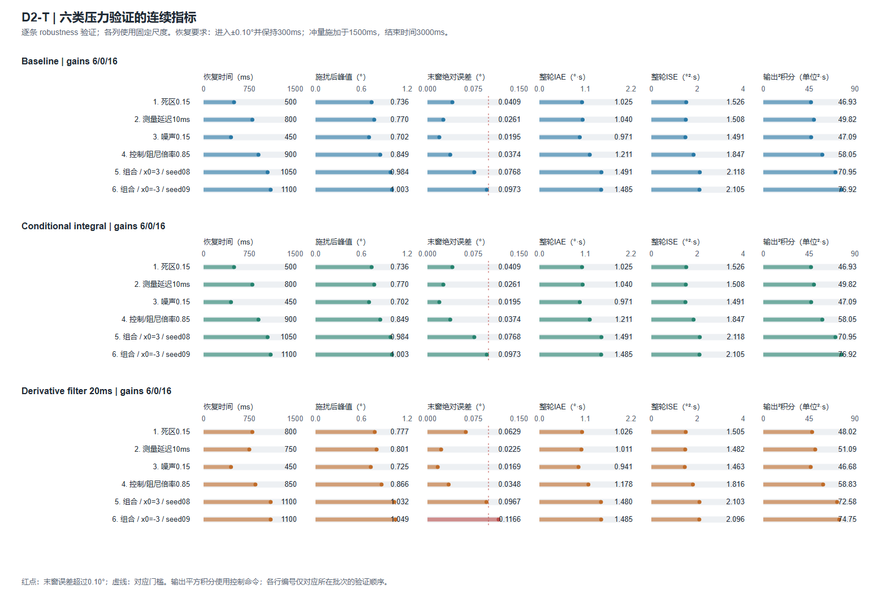](d2-t-pressure-diagnostics.svg)

先期与A–C验证诊断

[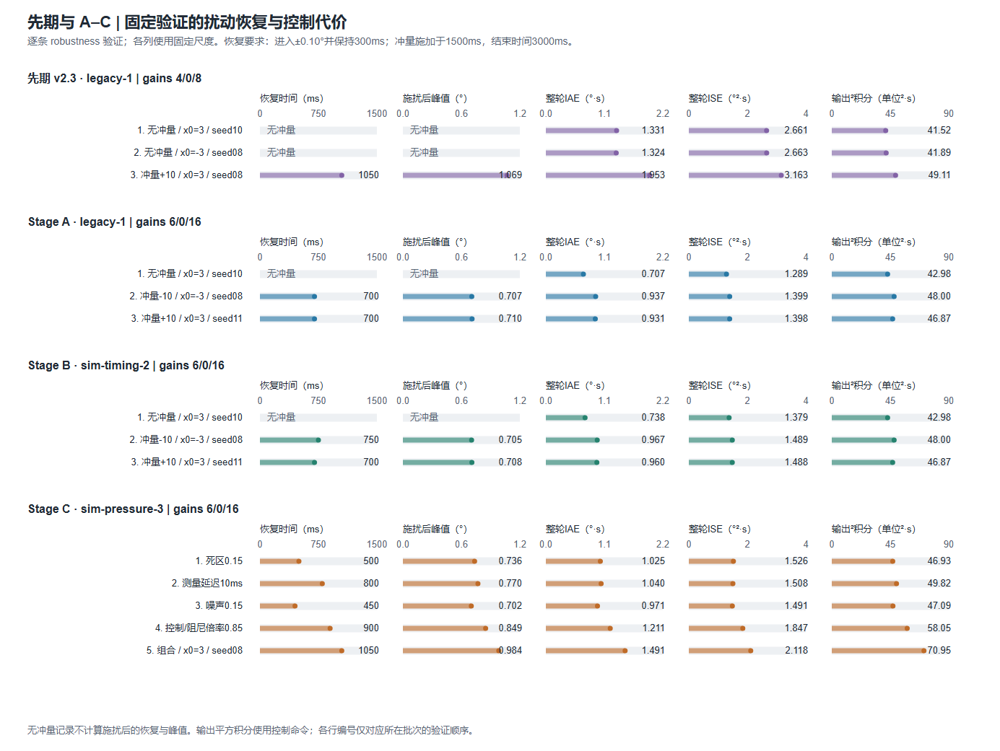](abc-validation-diagnostics.svg)

原D未收敛判据拆解

[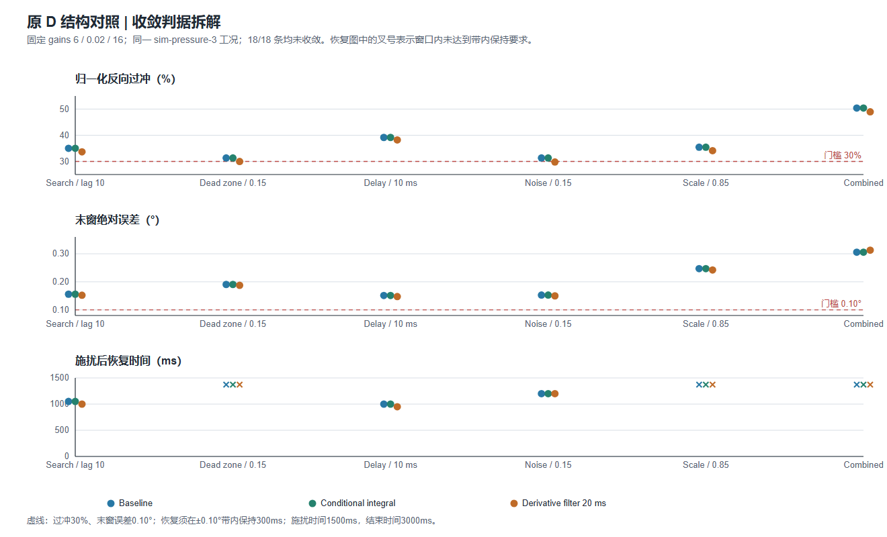](stage-d-criterion-breakdown.svg)

早期及A–C搜索轨迹

[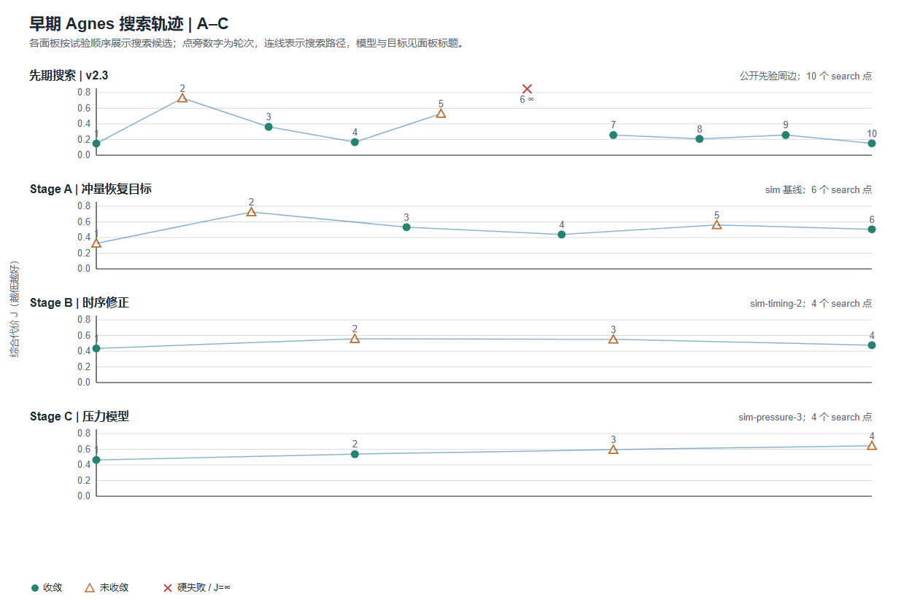](early-search-trajectories.svg)

Ki=0参数网格热图

[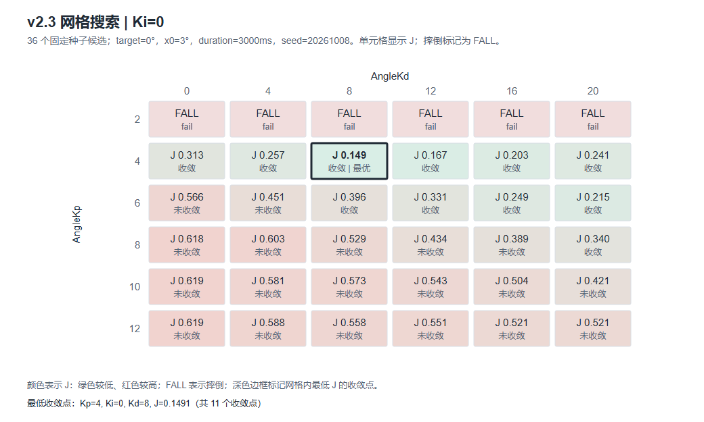](grid-v23-ki0-heatmap.svg)

selftest行为样例

[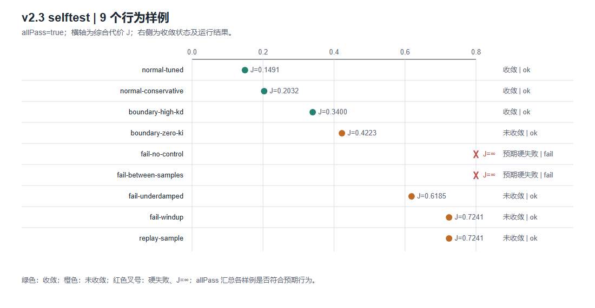](selftest-v23-outcomes.svg)

D2本机方法探索

[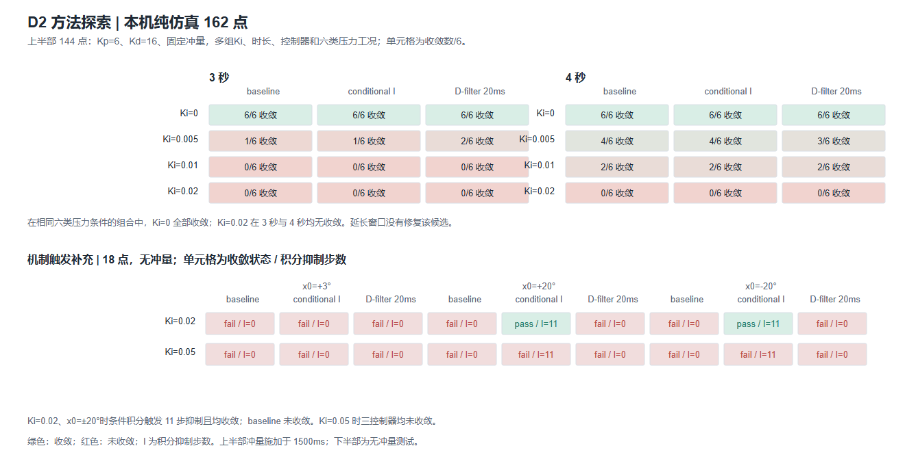](d2-method-exploration.svg)

Stage A搜索遥测

[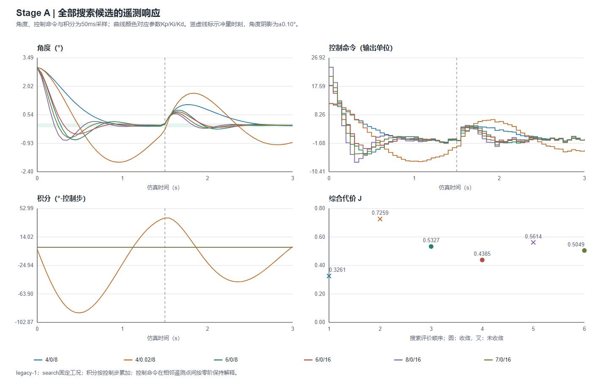](../agnes-stage-a-20261010/search-traces.svg)

Stage B搜索遥测

[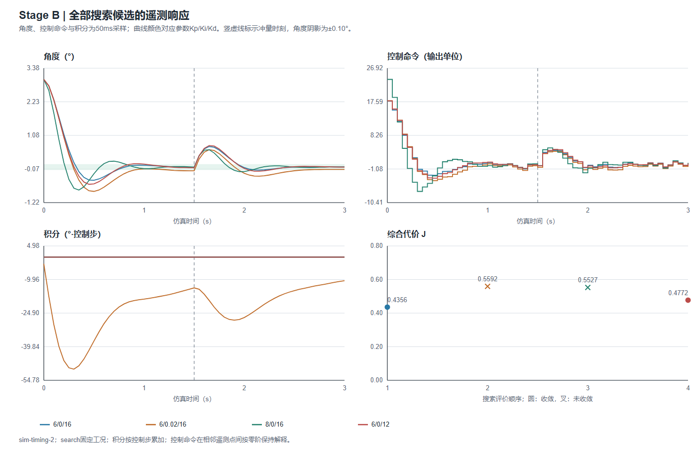](../agnes-stage-b-20261010/search-traces.svg)

Stage C搜索遥测

[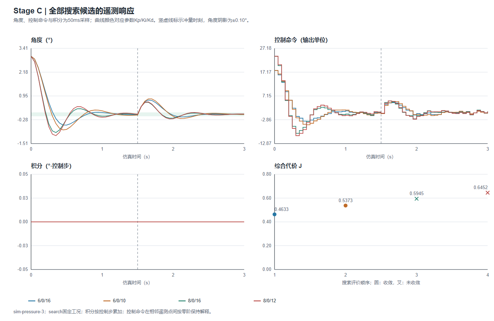](../agnes-stage-c-20261010/search-traces.svg)

