# 仿真实验与软件验证

数据日期：2026-10-10。文档整理日期：2026-10-11。

## 方法与数据

保存12批campaign、110条运行记录：57条参数搜索和53条独立验证。每批固定模型、控制器、评价口径和搜索条件，参数选择及理由保存在index.jsonl，原始遥测保存在同目录CSV。Agnes逐轮搜索与固定参数控制器对照分别统计。

另有v2.3固定网格36点、v2.3 selftest 9个样例和162点本机方法探索。网格及方法探索由脚本执行，不计入Agnes自主搜索轮数。各批模型映射见[历史实现](../versions/README.md)。

| Campaign | 总数 | Search | 验证收敛 | 最佳可行搜索J |
|---|---:|---:|---:|---:|
| [agnes-20261010-a](agnes-20261010-a/summary.json) | 13 | 10 | 2/3 | 0.1491 |
| [agnes-stage-a-20261010](agnes-stage-a-20261010/summary.json) | 9 | 6 | 3/3 | 0.4385 |
| [agnes-stage-b-20261010](agnes-stage-b-20261010/summary.json) | 7 | 4 | 3/3 | 0.4356 |
| [agnes-stage-c-20261010](agnes-stage-c-20261010/summary.json) | 9 | 4 | 5/5 | 0.4633 |
| [agnes-stage-d-baseline-20261010-agent](agnes-stage-d-baseline-20261010-agent/summary.json) | 6 | 1 | 0/5 | 无可行候选 |
| [agnes-stage-d-conditional-integral-20261010-agent](agnes-stage-d-conditional-integral-20261010-agent/summary.json) | 6 | 1 | 0/5 | 无可行候选 |
| [agnes-stage-d-derivative-filter-20261010-agent](agnes-stage-d-derivative-filter-20261010-agent/summary.json) | 6 | 1 | 0/5 | 无可行候选 |
| [agnes-stage-d2-m2-baseline-20261010](agnes-stage-d2-m2-baseline-20261010/summary.json) | 4 | 1 | 0/3 | 无可行候选 |
| [agnes-stage-d2-m2-conditional-integral-20261010](agnes-stage-d2-m2-conditional-integral-20261010/summary.json) | 4 | 1 | 3/3 | 0.4851 |
| [agnes-stage-d2-t-baseline-20261010](agnes-stage-d2-t-baseline-20261010/summary.json) | 12 | 6 | 6/6 | 0.4633 |
| [agnes-stage-d2-t-conditional-integral-20261010](agnes-stage-d2-t-conditional-integral-20261010/summary.json) | 16 | 10 | 6/6 | 0.4633 |
| [agnes-stage-d2-t-derivative-filter-20261010](agnes-stage-d2-t-derivative-filter-20261010/summary.json) | 18 | 12 | 5/6 | 0.4573 |

表中“验证收敛”只汇总metrics.converged；summary中的validationPassed还检查预定验证及施扰后恢复。先期批次没有完整plan，其余批次的plan及验证顺序已保存。

## 结果

### 初期网格与早期搜索

v2.3、Ki=0固定网格有11个收敛点，网格内最低收敛J为0.1491，参数4/0/8。先期Agnes搜索包含10个不同点和3项验证，最佳点仍为已公开先验，冲量验证未收敛。

Stage A在冲量恢复目标下完成6点搜索和3项验证，冻结候选6/0/16。Stage B修正仿真时序，完成4点搜索及3项验证；Stage C加入压力模型，完成4点搜索和5项验证。三批预定验证均通过。不同模型的J变化不作性能改善排名。

### 原D控制器对照

固定6/0.02/16、x0=3°、seed20261008、3秒窗口，1500ms施加+10°/s角速度冲量。baseline、conditional-integral和20ms derivative-filter各有1条固定参数search及5项压力验证。

18条记录均未收敛，未发生硬失败。18条末窗均值超出容差，16条归一化反向过冲超过30%，9条达到施扰后恢复要求。baseline与条件积分的配对CSV相同，全部控制环饱和/积分抑制步数为0：该工况没有触发条件积分机制。微分滤波同工况J略低，但未通过收敛门槛。

### D2-T自主搜索与压力验证

三控制器分别执行6、10、12个搜索点，各6个预定验证场景。最佳可行候选均为6/0/16，搜索J依次0.4633、0.4633、0.4573；验证收敛数为6/6、6/6、5/6。微分滤波在组合条件、负向初态、seed20261009时末窗误差为0.1166°，超出0.1°容差。

预算上限相同，实际轮数不同。Ki=0结果属于PD控制；Ki>0最佳可行点为6/0.002/16、J=0.4786。不同控制器的独立搜索候选不能当作同参数结构对照。

### D2-M2积分与饱和对照

固定6/0.02/16、执行器滞后10ms、3秒、无冲量，以±20°初态及两个seed形成四组配对。baseline四条未收敛，条件积分四条收敛。

| 指标 | Baseline | 条件积分 |
|---|---|---|
| J范围 | 0.5978–0.5983 | 0.4771–0.4851 |
| 归一化反向过冲 | 35.18%–35.24% | 26.18%–26.24% |
| 末窗绝对误差 | 0.4224–0.4254° | 0.1549–0.1576° |
| 调节时间 | 2650–2700ms | 1700–1750ms |
| 输出饱和步数 / 300 | 12 | 10–11 |
| 积分抑制步数 / 300 | 0 | 11 |
| 最大积分绝对值 | 约416 | 约214 |

这些工况的容差约0.383°，取自实际初始均值及评价设置。四组J均值为0.598025和0.483000，差约19.23%；只统计三组验证为0.597933和0.482300，差约19.34%。机制触发与性能比较分别记录，结果限于所测代理模型及条件。

## 图表

15组图表覆盖网格、行为样例、全部搜索批次、固定验证、失败判据与控制机制。每组提供SVG和PNG。[图表索引](figures/README.md)列出完整文件与来源。

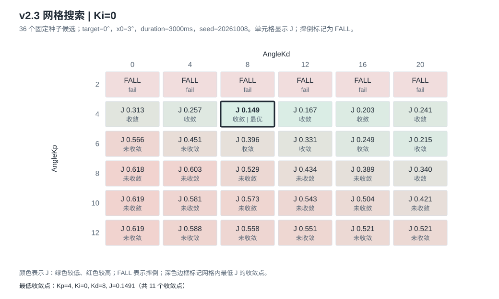
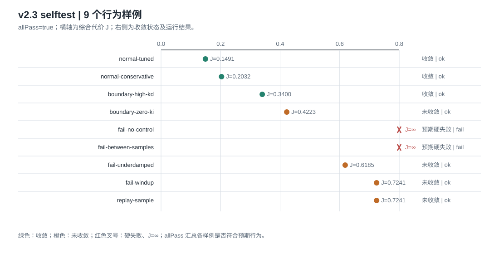
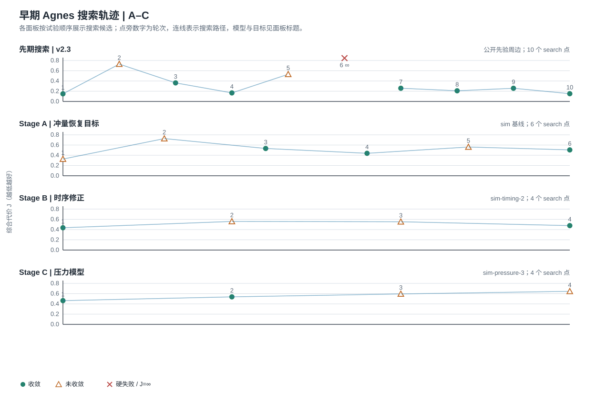
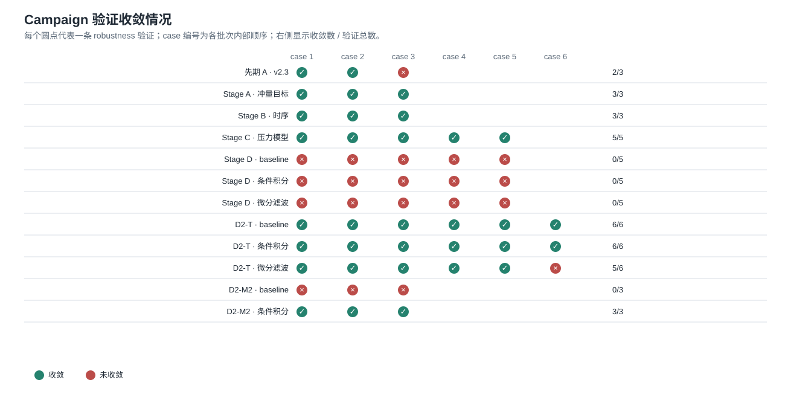
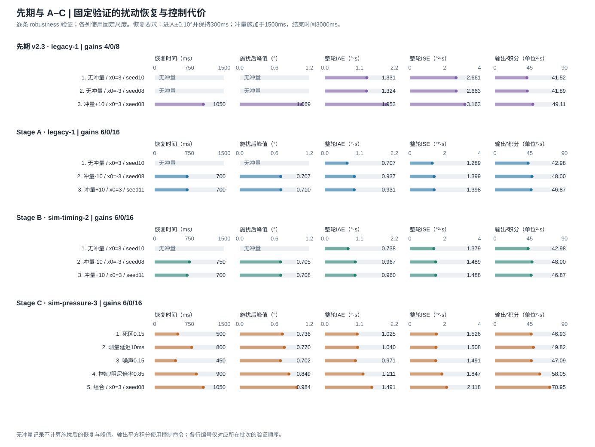
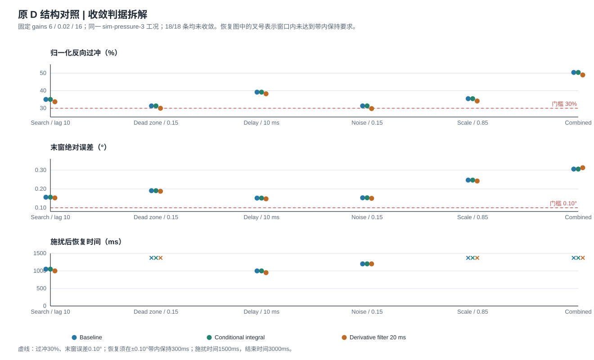
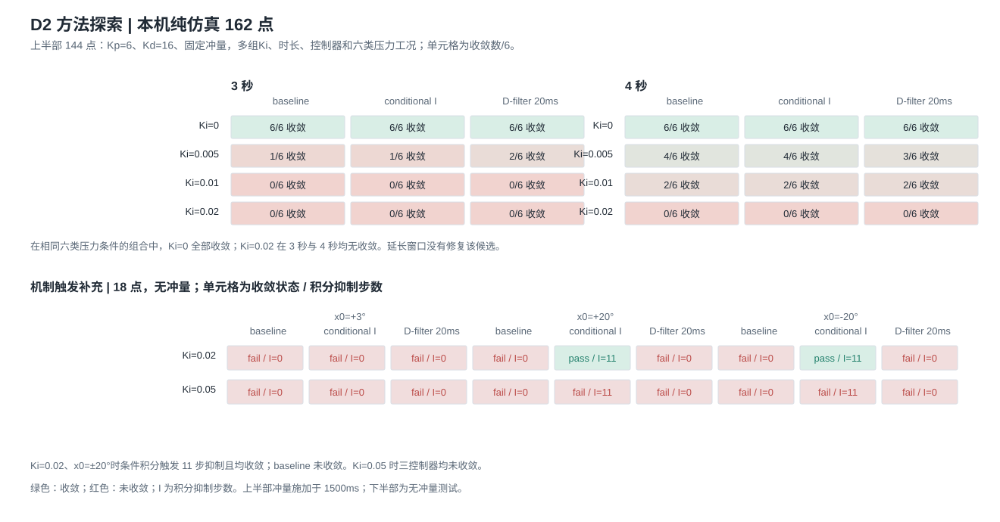
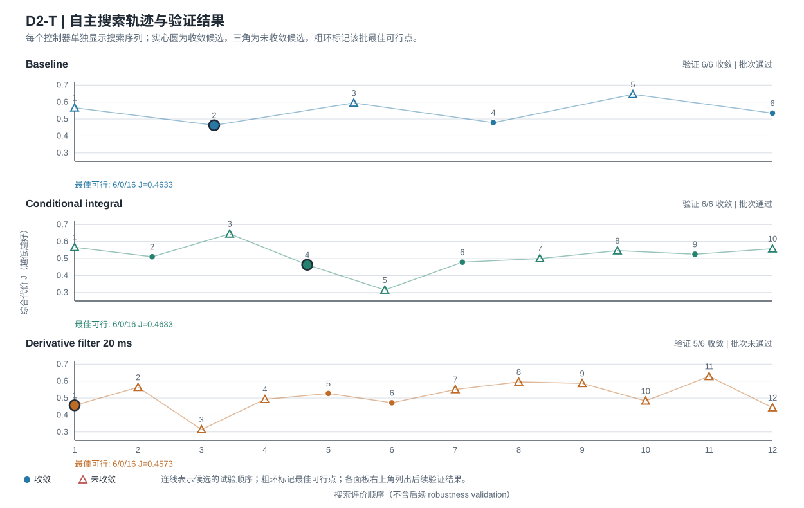
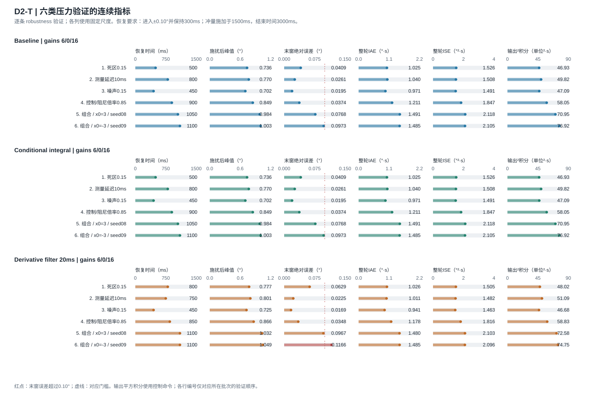
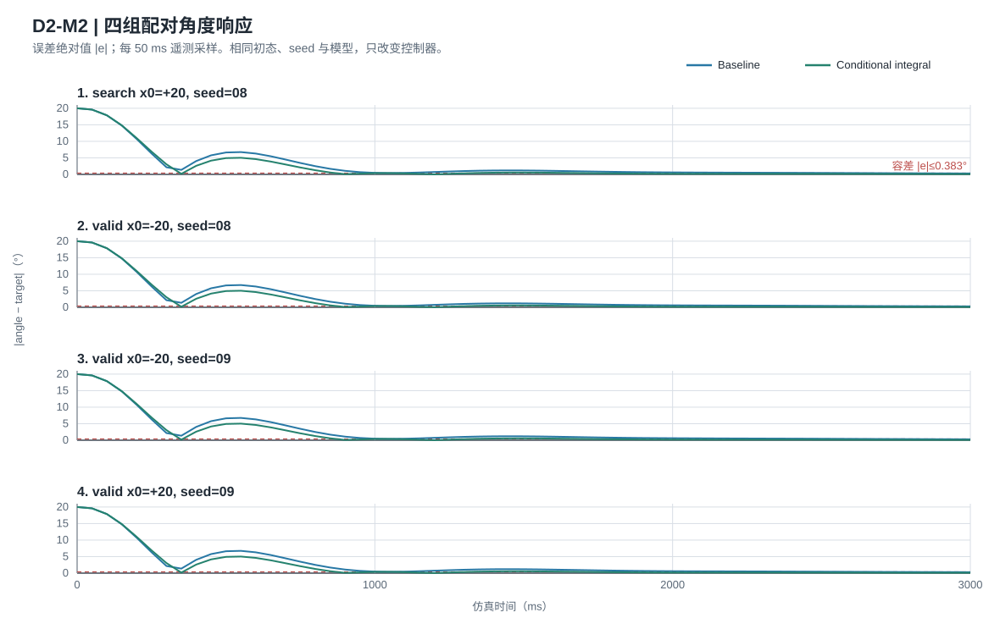
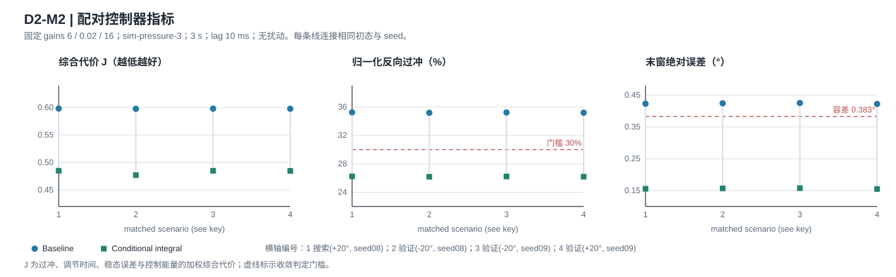
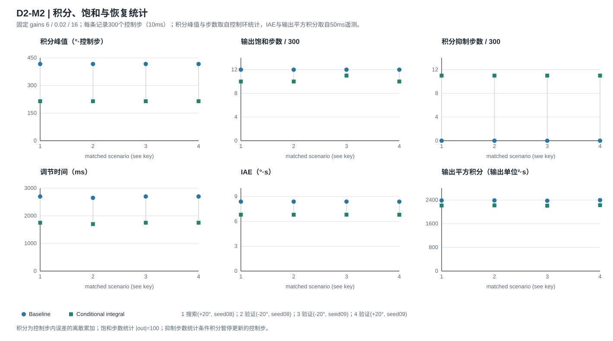

## 数值复现

`npm run verify:evidence`逐条校验CSV散列及评价结果：110条metrics、97条原有diagnostics、13条先期后补diagnostics全部一致；72条控制环统计和162条方法探索亦重现一致。先期后补诊断是原13条运行的派生值，不增加试验数。

`npm run verify:history`逐条重现110条campaign的完整采样序列及metrics，重现36个网格点与9个selftest样例。冻结实现只保留复算必要模块，修改注释时执行token序列保持一致；公开字节散列在manifest中单独标记。

CSV未改写，sourceHash仍指向历史完整项目。图中反向过冲使用百分比，角度误差使用度。输出平方积分基于控制命令，控制环统计与遥测采样分别标明来源。

## 会话审计

`npm run audit:sessions`检查10份导出。先期、A/B/C、原D范围及三个D2-T导出，共8份达到事件连续、effect配对、非负整数时长、结束事件及正式runId全覆盖的检查条件。

M2基线导出372个事件，覆盖4/4运行返回，但有1个未结算effect且缺少turn/end。M2条件积分导出57个事件，有1个未结算effect、缺少turn/end且未覆盖4条正式运行返回。两者均作为部分会话保存，不补写。完整数值证据和部分会话证据分别使用；审计摘要见[session-audit.json](../01_agh/session-audit.json)。

## 软件与设备状态

| 验证 | 结果 |
|---|---|
| 当前整理版本 `npm test` | 68/68通过，含34项串口桩测试 |
| 当前整理版本 selftest | allPass=true，9个样例 |
| 历史Windows/WSL回归 | 各68/68通过，同一用例集 |
| 各阶段selftest | 保存对应版本的9样例结果 |
| 实车固件/串口验收 | 尚未执行 |

串口桩注入FakeSerialPort，不打开实际设备。当前固件说明缺少命令确认和实际参数读回，主机拒绝无法确认的继续动作，设备状态保持unknown。运行条件见[串口说明](../../docs/serial.md)。

代理模型尚无实车辨识；试验不覆盖长时保持、所有初态或一般工况。不同seed的少量验证用于检查预定场景，不作为总体统计推断。
